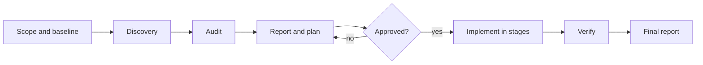

# Project Audit Skill

[](https://github.com/engida32/project-audit-skill/actions/workflows/validate.yml)
[](https://www.python.org/downloads/)
[](LICENSE)

**Status: v0.1.0**

A portable Agent Skill for evidence-based repository audits, prioritized
remediation plans, and staged refactoring.

A generic "audit this repo" prompt can produce a long list of advice without
showing its work. This skill forces the agent to work from the current tree,
cite evidence, separate findings from guesses, and stop before making risky
changes.

## What it does

- Audits architecture, code quality, dead code, complexity, dependencies,
  security, performance, tests, documentation, repository hygiene, operations,
  release readiness, and frontend accessibility when applicable.
- Defaults to report-and-plan. It does not edit files until you approve a
  finding, a stage, or a plan.
- Produces findings with severity, confidence, verification, location, evidence,
  impact, recommended fix, risk, validation, and effort.
- Independently checks P0 and P1 findings, and marks single-pass checks in the
  report limitations.
- Resumes from an existing audit artifact and treats the current tree as
  authoritative when they disagree.
- Supports a safe-fix mode for behavior-preserving changes and a refactor mode
  for approved structural work.
- Includes safety gates for secrets, destructive commands, history rewrites,
  breaking API or schema changes, and publishing.
- Ships with a validator and tests so the skill stays portable and free of
  private paths or obvious secrets.

## What it does not do

- It is not a replacement for a human security review or a dedicated scanner.
- It is not permission to rewrite Git history, delete user data, or publish a
  project.
- It does not guarantee that every path was inspected. The report records what
  was sampled and what was skipped.
- It is not an automatic refactor bot. The default output is a report and a
  plan.

## Honest limits

The skill samples instead of reading everything, the model can miss issues, and
false positives happen. Repository content can also carry prompt injection, and
the skill is not a security guarantee. See [known issues](KNOWN_ISSUES.md) for
the full list, including platform path drift and unverified fixes.

## Install

The installable unit is `skills/project-audit/`. Copy it into the skills
directory your agent reads.

```sh
mkdir -p "$HOME/.agents/skills"
cp -R skills/project-audit "$HOME/.agents/skills/"
```

Or use the installer, which refuses to overwrite an existing copy:

```sh
sh install.sh
sh install.sh "$HOME/.config/opencode/skills"
sh install.sh .agents/skills
sh install.sh --help
```

`--force` backs up an existing install before replacing it, and `--uninstall`
removes an install that contains `SKILL.md`.

For a project-local install, commit `.agents/skills/project-audit/` so the whole
team gets the same instructions.

Common paths include `~/.agents/skills/`, `~/.claude/skills/`,
`~/.config/opencode/skills/`, and `.agents/skills/`. Discovery and invocation
differ between agents. See
[platform install notes](skills/project-audit/references/platform-install.md)
and verify the path for your installed version.

## Usage

Report-only audit:

```text
Use project-audit in report mode on this repository. Do not edit files.
Return the findings table and a staged fix plan with evidence.
```

Dependency and security review:

```text
Use project-audit to review the dependency and security posture of this repo.
Report only, then propose a safe-fix plan for P1 findings.
```

Open-source readiness:

```text
Use project-audit to prepare this project for open source. Check docs, license,
CI, repository hygiene, and release readiness. Do not publish anything.
```

Approved safe fixes:

```text
Apply the approved P2 findings from AUD-004 and AUD-007. Use safe-fix mode.
Keep one logical change per commit and run the focused tests after each.
```

## How it works



The skill starts with the repository state, the toolchain, and the commands the
project actually uses. It then applies the audit lenses that fit the project and
records findings with current-tree evidence. The fix plan is separate from the
findings so you can approve work in stages.

## Run under agent-workflow-kit

Long audits benefit from a harness that can pause, resume, and verify. The
[agent-workflow-kit](https://github.com/engida32/agent-workflow-kit) provides a
resumable workflow with an explicit verification loop, so a multi-stage audit
can survive an interrupted session and keep its evidence across runs. Install
the skill normally, then use the kit to carry the audit through approval and
remediation stages.

## Repository structure

```text
.
├── skills/project-audit/
│   ├── SKILL.md
│   ├── TESTS.md
│   └── references/
│       ├── audit-playbook.md
│       ├── findings-and-severity.md
│       ├── platform-install.md
│       └── report-template.md
├── scripts/validate_skill.py
├── tests/
│   ├── test_validate_skill.py
│   └── test_install.py
├── docs/
│   ├── design-notes.md
│   └── example-report.md
├── evals/
│   ├── README.md
│   ├── expected-findings.md
│   └── fixture/
├── .github/
│   ├── CODEOWNERS
│   ├── dependabot.yml
│   ├── PULL_REQUEST_TEMPLATE.md
│   ├── ISSUE_TEMPLATE/
│   └── workflows/
├── AGENT_PROMPT.md
├── install.sh
├── README.md
├── CONTRIBUTING.md
├── CODE_OF_CONDUCT.md
├── GOVERNANCE.md
├── SECURITY.md
├── KNOWN_ISSUES.md
├── CHANGELOG.md
└── LICENSE
```

## Design principles

- Evidence before assertion. A finding needs a location, a mechanism, and a
  way to confirm it.
- Report before edit. The default mode is read-only.
- Simple before clever. A refactor needs a measurable benefit.
- Verify before claiming. A test result needs the command and the output.
- Safety before speed. Secrets, user data, published history, and breaking
  changes are approval gates.

See [design notes](docs/design-notes.md) for the review of the original prompt
and the reasoning behind these choices.

## Validation

The validator checks frontmatter, name and description rules, line count,
relative links, absolute home paths, and obvious secret patterns.

```sh
python3 scripts/validate_skill.py skills/project-audit
python3 -m unittest discover -s tests -v
```

Python 3.10 or newer is required for the validator.

## Contributing

Read [CONTRIBUTING.md](CONTRIBUTING.md). Keep changes focused, run the validator
and tests, and do not include private paths or secrets. By taking part you agree
to the [Code of Conduct](CODE_OF_CONDUCT.md). Decisions, versioning, and release
steps live in [GOVERNANCE.md](GOVERNANCE.md).

## Maintainers

The project has a single maintainer. Useful references:

- [GOVERNANCE.md](GOVERNANCE.md): roles, versioning, and repository settings.
- [CODE_OF_CONDUCT.md](CODE_OF_CONDUCT.md): expected behavior and reporting.
- [AGENT_PROMPT.md](AGENT_PROMPT.md): the prompt that packages the skill.
- [skills/project-audit/TESTS.md](skills/project-audit/TESTS.md): manual test
  prompts for the skill.
- [evals/README.md](evals/README.md): evaluation notes and cases.
- [docs/example-report.md](docs/example-report.md): a sample audit report.

Release checklist:

1. Confirm the required `validate` check is green on `main`.
2. Run the validator, unit tests, `bash -n install.sh`, and the installer smoke
   test locally.
3. Update `CHANGELOG.md` and bump the version only when the release is approved.
4. Tag the release and publish notes from the changelog.
5. Do not rewrite published history.

## Security

Read [SECURITY.md](SECURITY.md). Prefer
[GitHub private vulnerability reporting](https://github.com/engida32/project-audit-skill/security/advisories/new)
for unsafe guidance that could cause data loss or secret exposure. Email is the
fallback.

## License

MIT. See [LICENSE](LICENSE).

## Author

Engida Lishan

- Website: [engida.devs.et](https://engida.devs.et)
- Email: [Send a message](mailto:engida32lishan@gmail.com)
