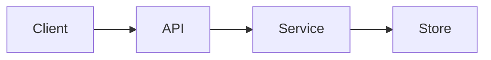

# Audit Report Template

Use this structure for the report. Keep it readable. Put long evidence in an
appendix or an artifact and link it.

## A. Executive summary

Two or three paragraphs:

- What the repository is and what state it was in.
- The most important risks or costs found.
- What changed, if anything, and what is still open.

Lead with the conclusion. Do not bury a P0 in a list of minor cleanup.

## B. Scope and baseline

| Item | Value |
| --- | --- |
| Repository | `<path or URL>` |
| Commit | `<sha>` |
| Branch | `<branch>` |
| Working tree | `<clean or files>` |
| Mode | `report`, `safe-fix`, or `refactor` |
| Included paths | `<paths>` |
| Excluded paths | `<paths and why>` |
| Timebox | `<if any>` |
| Target | `<production, open source, security, cleanup>` |

Record the baseline commands and results:

```text
<command> -> exit <code>, <summary>
```

## C. Findings

| ID | Severity | Confidence | Verification | Category | Title | Status |
| --- | --- | --- | --- | --- | --- | --- |
| AUD-001 | P0 | confirmed | independent | Security | ... | open |
| AUD-002 | P1 | likely | single-pass | Architecture | ... | planned |

Then one section per finding, using the schema in
`findings-and-severity.md`. Include evidence, impact, fix, risk, validation, and
effort. Mark every P0 and P1 that had no independent check as
`verification: single-pass`, and list the unverified findings in the coverage
and limitations section.

## D. Architecture

Describe the actual architecture, not the intended one. Show the important
boundaries and the places where they leak. Include a small Mermaid diagram only
when it clarifies the flow.



Explain the diagram in one paragraph. Do not add a diagram that repeats the
directory tree.

## E. Code quality and complexity

Summarize dead code, duplication, oversized modules, and unnecessary
abstractions. Link each claim to a finding. Explain what was removed or
simplified, and what was intentionally left alone.

## F. Dependencies

| Package | Change | Reason | Validation |
| --- | --- | --- | --- |
| ... | removed, added, updated | ... | ... |

Include lockfile changes. State whether the license and vulnerability checks
were run.

## G. Security and privacy

List confirmed issues first. For each, state the trust boundary, the impact, and
the remediation status. If a secret was exposed, state the rotation status and
the history-cleanup recommendation. Never include the secret value.

## H. Performance

Include measurements only when they exist. State the environment and the input.
If no measurement was possible, say so and describe the evidence used.

## I. Tests and verification

```text
<command> -> exit <code>, <result>
```

List tests added, changed, or removed. Explain any remaining failures and
whether they predate the audit.

## J. Documentation

List documentation changed and why. Note commands that were verified and
commands that could not be run.

## K. Repository cleanup

| Path | Action | Reason |
| --- | --- | --- |
| ... | removed, ignored, kept, archived | ... |

State whether Git history was rewritten. If not, say so.

## L. Changes made

If the mode allowed edits, list them by stage:

| Stage | Files | Behavior change | Verification |
| --- | --- | --- | --- |
| ... | ... | none or ... | ... |

If no edits were made, say "Report-only; no files changed."

## M. Outstanding issues

List unresolved findings, unverified assumptions, and checks that could not run.
Give the next action for each. Do not hide a known failure in this section.

## N. Final status

| Area | Status | Evidence |
| --- | --- | --- |
| Build | pass, fail, or not run | command and result |
| Tests | pass, fail, or not run | command and result |
| Lint | pass, fail, or not run | command and result |
| Typecheck | pass, fail, or not run | command and result |
| Security | pass, issues, or not run | command and result |
| Documentation | complete or gaps | paths |
| Git tree | clean or dirty | `git status --short` |
| Release ready | yes, no, or conditional | reason |

End with a short recommendation: ship, fix P0/P1 first, or return to planning.

## O. Coverage and limitations

State what was inspected, sampled, excluded, or not checked. A short honest list
is more useful than a claim of completeness.
